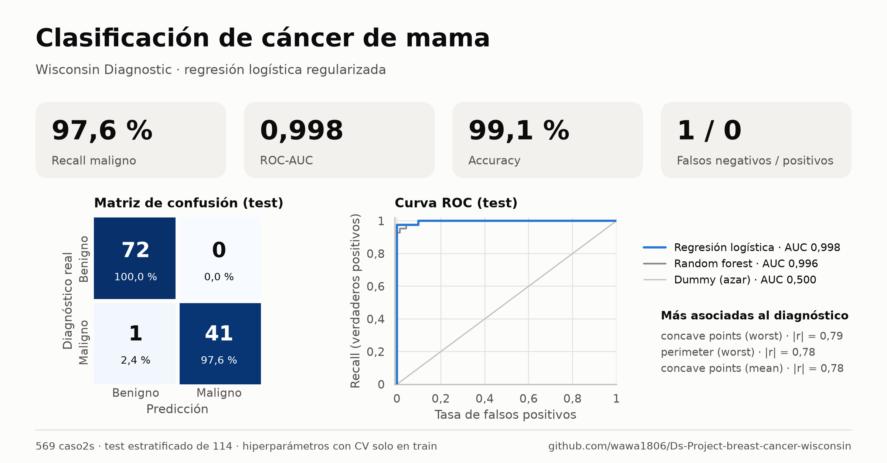
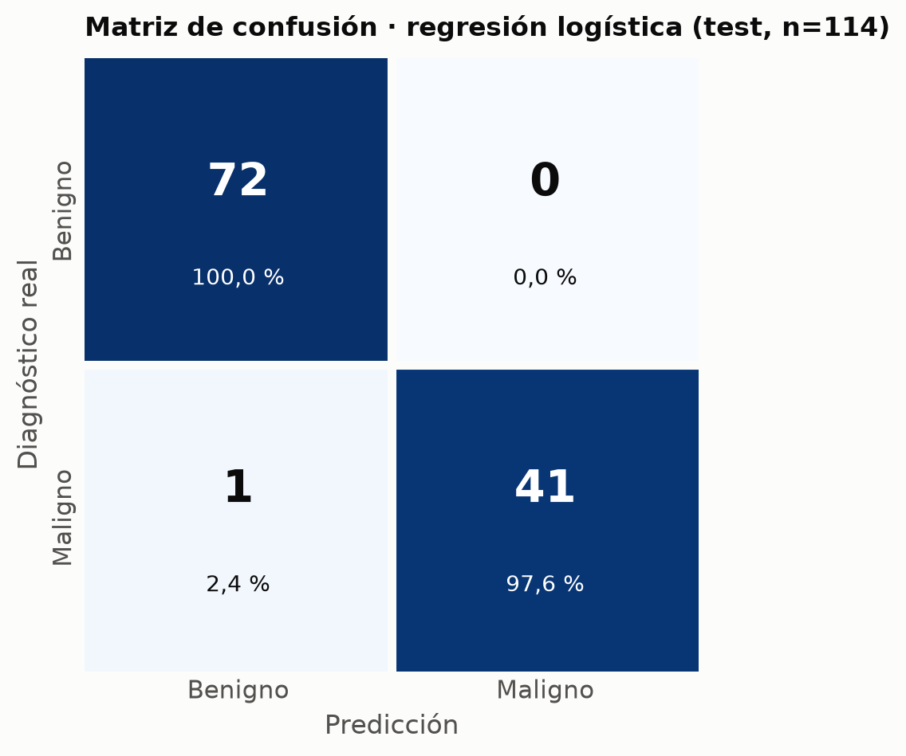
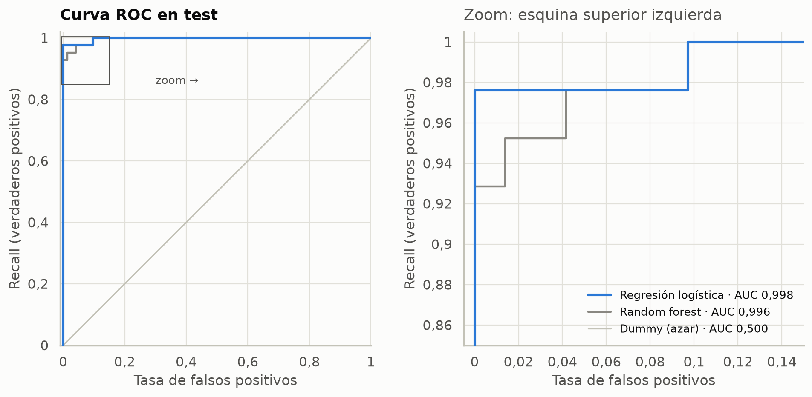
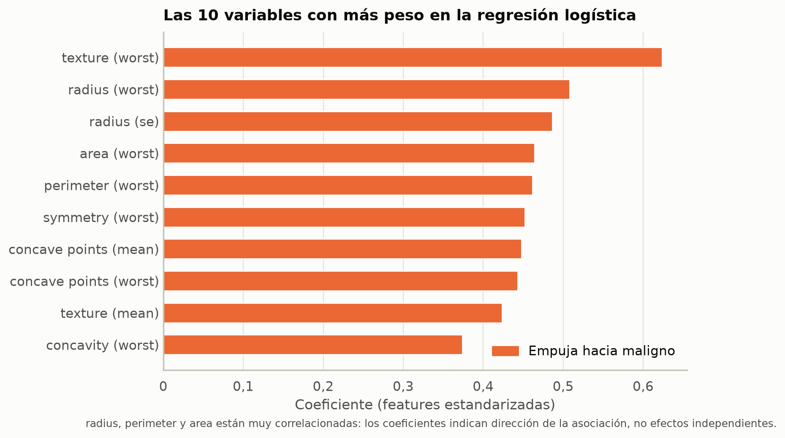

# Clasificación de cáncer de mama (Wisconsin Diagnostic)



Modelo de clasificación binaria para distinguir tumores **malignos** de **benignos** a partir de características nucleares extraídas de una aspiración con aguja fina (FNA).

Un falso negativo (maligno etiquetado como benigno) es más costoso que un falso positivo. La métrica principal es el **recall de la clase maligna**.

Dataset: [Breast Cancer Wisconsin (Diagnostic)](https://www.kaggle.com/datasets/uciml/breast-cancer-wisconsin-data) — 569 muestras, 357 benignas y 212 malignas, 30 features numéricas.

## Resultado

Test estratificado (114 casos). El escalado y los hiperparámetros se ajustan **solo en train**.

| Modelo | Accuracy | Recall (M) | F1 (M) | ROC-AUC |
|---|---|---|---|---|
| Dummy (mayoritaria) | 0.632 | 0.000 | 0.000 | 0.500 |
| **Regresión logística** | **0.991** | **0.976** | **0.988** | **0.998** |
| Random forest | 0.965 | 0.929 | 0.951 | 0.996 |

La regresión logística regularizada es el modelo elegido: más simple y con mejor recall (1 falso negativo, 0 falsos positivos).

<p align="center">
  
</p>



## Enfoque

1. Limpieza: se elimina `id` y la columna vacía `Unnamed: 32`. `M → 1`, `B → 0`.
2. Split 80/20 **estratificado** *antes* de cualquier transformación.
3. `Pipeline` de scikit-learn: `StandardScaler` + modelo (el forest no escala).
4. `GridSearchCV` + `StratifiedKFold(5)` sobre train, scoring = recall de maligno. `refit=True` reentrena el mejor modelo en todo el train.
5. El test se evalúa una sola vez.

Las variables de tamaño (`radius`, `perimeter`, `area`) están casi duplicadas. Sirven para predecir; los coeficientes de la logística no se leen como efectos independientes. La señal se concentra en `concave points`, `perimeter` y `radius` (sobre todo *worst*): núcleos más grandes e irregulares se asocian a malignidad.



## Cómo ejecutarlo

Requiere [uv](https://docs.astral.sh/uv/) y Python ≥ 3.12.

```bash
uv sync
uv run jupyter notebook notebooks/clasificacion_cancer_mama.ipynb
```

## Estructura

```
data/data.csv
notebooks/clasificacion_cancer_mama.ipynb   # análisis + sección 10 que genera las figuras
reports/figures/                            # PNG del README e infografía para LinkedIn
pyproject.toml
```

## Limitaciones

569 muestras de un solo centro, con features ya diseñadas (no hay imagen cruda). No sustituye un diagnóstico clínico. Un siguiente paso razonable es calibrar el umbral según el coste de un falso negativo.
